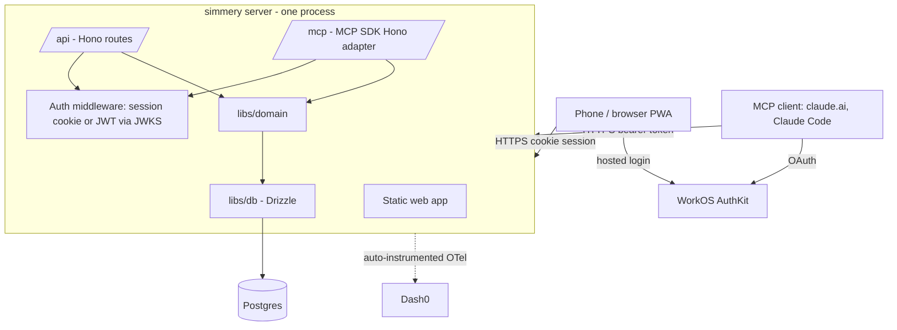
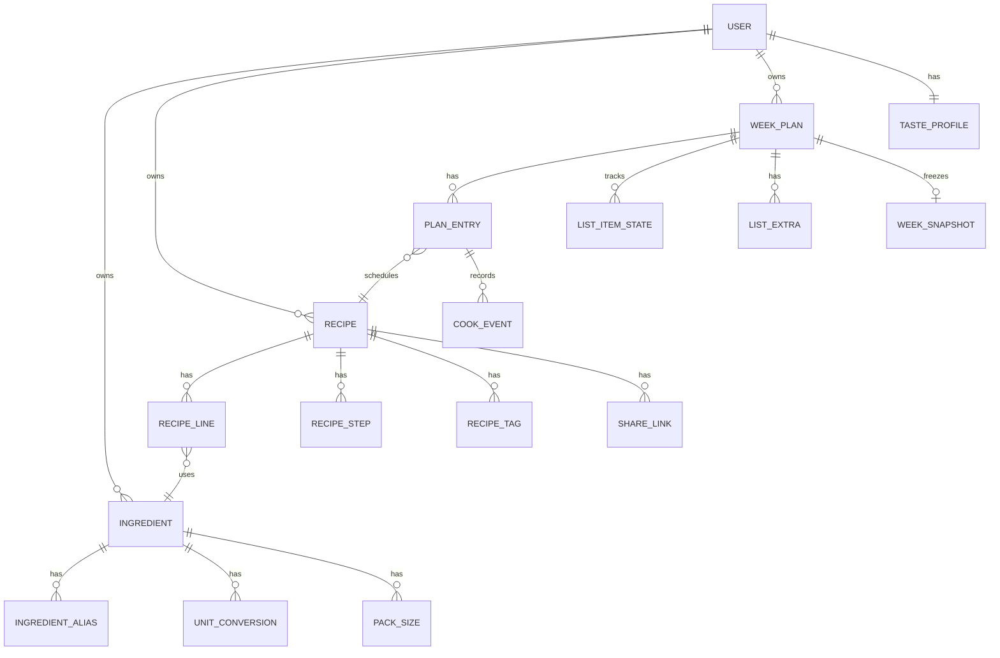
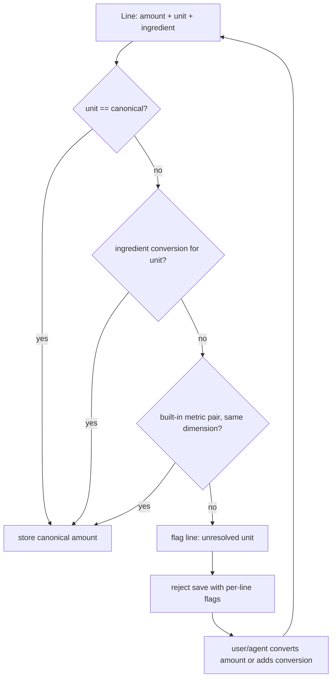
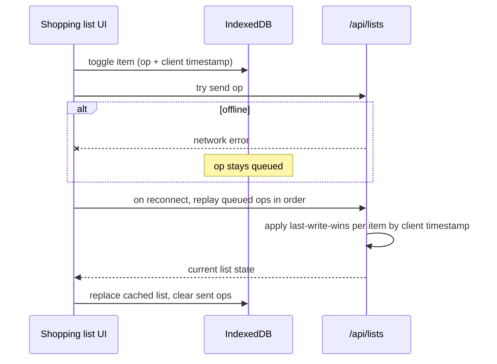

# Simmery Foundation - Plan

## Goal Capsule

- **Objective:** A small invited group can run their weekly cooking without a meal box: keep their own recipes, plan a week (alone or with an AI agent), shop from one aggregated list in the store, and cook from scaled recipes, with little food wasted.
- **Product authority:** This Product Contract. It covers the whole thin v1 loop (recipes, ingredients, weekly plan, shopping, cooking, statistics, taste profile, sharing, MCP access) at basic depth. Deepening any single area is later work.
- **Means:** One TypeScript service (Hono + Drizzle on Postgres) serving a React PWA, a typed JSON API and a remote MCP endpoint over one shared domain library, signed in through WorkOS AuthKit (KTD1, KTD2, KTD3).
- **Authority order:** Product Contract Requirements win on behavior; Planning Contract KTDs win on mechanism; units carry only local detail.
- **Stop conditions:** Stop and ask if a requirement cannot be met as written, if WorkOS AuthKit cannot gate sign-up to invitations or serve MCP OAuth, or if a unit would need data shared across users.
- **Execution profile:** Units U1–U10 and U12 land as separate PRs in dependency order; U11 builds and publishes the image and chart, while the live rollout waits on the cluster prerequisites (THI-49, THI-50).
- **Open blockers:** None for building U1–U11. The live rollout at the end of U11 waits on THI-49 (public exposure path) and THI-50 (Postgres on the cluster).
- **Product Contract preservation:** changed: R17 (per-line pack suggestions) removed and AE2 rewritten — the user decided during plan review that buying packs is left to them and pack sizes only drive least-waste leftover estimates. Outstanding Questions resolved during planning were removed and now live in KTDs.

---

## Product Contract

### Summary

Simmery is a self-hosted recipe and meal-planning system with a mobile-first website and a remote MCP server over the same per-user data.
The website covers recipe entry, manual weekly planning, an offline-capable shopping list, a cooking view and statistics.
The MCP server lets a user's own AI agent propose weeks, maintain the taste profile and add recipes.

### Problem Frame

The primary user has relied on meal-box delivery services for a long time and is moving away from them.
The boxes provided three conveniences that disappear with them: the week's meals were chosen for you, the ingredients arrived in amounts that matched the meals so little went to waste, and every meal came with a clear step-by-step card.
Today, finding recipes happens through web search and nothing connects choosing meals, buying ingredients and cooking them.
Friends in the same situation would benefit from the same tool and from passing good recipes to each other.

### Actors

- A1. User — an invited person with their own account, data and taste profile.
- A2. User's agent — an AI agent (e.g. Claude) connected to Simmery over MCP, acting with that user's permissions only.
- A3. Link viewer — anyone holding a recipe share link, with or without an account.

### Key Decisions

- **Invite-only circle now, public sign-up possible later.** Accounts are per person; nothing assumes a single household or a single operator beyond the invite gate. Governs R1, R2.
- **Every user owns their own ingredient catalog** (session-settled: user-directed — chosen over one shared global catalog: no single user can be trusted with edits that change everyone's recipe data, and correcting duplicates across users gets complicated). Governs R3, R4, R5, R6, R23.
- **Each ingredient has one canonical unit and any number of pack sizes** (session-settled: user-directed — added during synthesis review: several pack sizes are often available, and a stored unit makes mismatches like "2 cloves + 50 g" detectable at entry and keeps a user's data consistent). Governs R4, R5, R6, R13.
- **Recipes enter through the MCP agent or a manual web form** (session-settled: user-directed — chosen over server-side URL import and photo/OCR: the agent already covers pasted pages). Governs R7, R8.
- **Finding new recipes is outside Simmery.** Discovery happens in web search or in the agent's own tools; Simmery stores what it is given. Governs R8.
- **Weekly plans and shopping lists belong to one user** (session-settled: user-directed — chosen over household groups and shareable plans: keep the model simple). Governs R10.
- **A week is a set of meals, not a calendar.** Like a meal box, a week holds N recipes each with a serving count; putting them on days is optional. Governs R10, R11.
- **The planning intelligence lives in the agent, not the backend** (session-settled: user-approved — chosen over a built-in suggestion heuristic and an embedded on-site LLM chat: no model costs or keys in the product). The site supports manual planning with overlap and leftover feedback. Governs R12, R13, R25.
- **The taste profile is freeform notes the agent maintains** (session-settled: user-directed — chosen over structured preferences and structured-plus-notes). As a result the system enforces no allergies or exclusions; that responsibility sits with the agent and the user. Governs R21, R22.
- **Sharing is a read-only link plus import-as-copy** (session-settled: user-directed — chosen over copy-only, live shared recipes and link-only). Governs R23, R24.
- **Shopping mode is an installable, offline-capable checklist** (session-settled: user-approved — chosen over online-only and exporting to another app: stores have bad reception). Governs R15.
- **Hosting: the user's home k3s cluster, publicly reachable** (session-settled: user-approved — chosen over tailnet-only and a managed cloud host: remote MCP connectors such as claude.ai need a public HTTPS endpoint). Governs R2, R27.
- **Authentication through a managed auth service** (session-settled: user-directed — chosen over social login with the app as its own OAuth server, a self-hosted IdP, and passkeys/magic links). The same identity backs website sessions and MCP OAuth. Governs R1, R26.
- **Full-stack TypeScript** (session-settled: user-directed — chosen over a Go API with a TS SPA and over a TS meta-framework). One TypeScript backend serves the web API and the MCP endpoint over one domain layer; a separate TS frontend; Postgres for storage. Delivery mirrors `tiny-dash`: Nx/pnpm monorepo, container images on GHCR, Helm chart, OpenTelemetry to Dash0, conventional-commit releases.

### Requirements

**Accounts and access**

- R1. People sign in through the managed auth provider, and only invited email addresses can create an account.
- R2. Every piece of user data (recipes, catalog, plans, lists, history, profile) is visible and editable only by its owner, except recipes reached through a share link (R23).

**Ingredient catalog**

- R3. Each user has a private catalog of ingredients; every recipe ingredient line references an entry in the owner's catalog.
- R4. A catalog ingredient has a name, optional aliases, one canonical unit (e.g. g, ml, piece, clove) and zero or more common pack sizes expressed in that unit.
- R5. An ingredient can carry conversions from other units into its canonical unit (e.g. "1 clove ≈ 5 g", "1 tbsp ≈ 15 ml").
- R6. Whenever a recipe amount arrives in a unit that is neither the canonical unit nor covered by a conversion (form, agent or import), it is flagged at entry and must be resolved by converting it or adding a conversion before it is saved.

**Recipes**

- R7. A user can create and edit recipes on the website: title, servings, ingredient lines (catalog ingredient, amount, unit, optional note), ordered steps, tags (e.g. cuisine, protein, vegetarian) and an optional source URL.
- R8. The agent can create and edit recipes over MCP with the same fields, including matching ingredient lines to existing catalog entries or proposing new ones.
- R9. Ingredient entry on the website autocompletes against the user's catalog and offers to create a new entry when nothing matches.

**Weekly plan**

- R10. A user has one plan per week holding a set of recipes, each with its own serving count and an optional day.
- R11. A user can add, remove and re-serve recipes in a week on the website, and the agent can do the same over MCP.
- R12. While planning, the website shows the week's ingredient overlap (ingredients used by more than one meal) and estimated leftovers.
- R13. Leftover estimates use the closest fit from an ingredient's pack sizes against the week's total; ingredients without pack sizes show no leftover estimate.

**Shopping**

- R14. A week's shopping list sums amounts per catalog ingredient across all planned meals, scaled to their serving counts, in the canonical unit.
- R15. The shopping list works on a phone as an installable app; the current list is available offline and check-offs made offline sync when connectivity returns.
- R16. A user can add free-text extra items to the list.

**Cooking**

- R18. A recipe view scales ingredient amounts to the planned serving count and presents steps one at a time or as a list, readable on a phone.
- R19. After cooking, a user marks the meal cooked and optionally rates it.

**Statistics**

- R20. The website shows per-user statistics: cook history (how often and when each recipe was cooked, recipes not cooked in a while), ratings over time, variety across tags per week, most-bought ingredients, and leftover and overlap trends per week.

**Taste profile**

- R21. Each user has one freeform taste profile document, editable on the website.
- R22. The agent can read and update the taste profile over MCP.

**Sharing**

- R23. A user can create a read-only share link for a recipe; anyone with the link can view it without an account, and the owner can revoke the link.
- R24. A signed-in viewer can import a shared recipe as their own copy; during import every ingredient line is mapped to the importer's catalog (existing or new entries), unit checks per R6 apply, and the copy records whom it came from.

**MCP server**

- R25. The MCP server exposes tools for the user's recipes, catalog, weekly plans, shopping list, cook history, statistics and taste profile, including a tool to evaluate a candidate week (overlap, leftovers, variety) without saving it.
- R26. MCP clients authenticate with OAuth against the same identity as the website and act only as that user.
- R27. The MCP server is reachable over public HTTPS so remote connectors (claude.ai web and mobile) and local agents (Claude Code) can both use it.

### Key Flows

- F1. Agent-planned week
  - **Trigger:** The user asks their agent to plan next week.
  - **Actors:** A1, A2
  - **Steps:** The agent reads the taste profile, cook history and ratings; selects candidate recipes; evaluates candidate weeks for overlap, leftovers and variety; saves the chosen week with serving counts; the user adjusts it on the website.
  - **Covered by:** R10, R11, R12, R20, R22, R25
- F2. Shop and cook
  - **Trigger:** A week is planned.
  - **Actors:** A1
  - **Steps:** The user opens the shopping list on the phone, adds extras, shops offline, checks items off; later cooks each meal from the scaled recipe view and marks it cooked with a rating.
  - **Covered by:** R14, R15, R16, R18, R19
- F3. Agent adds a found recipe
  - **Trigger:** The user hands their agent a recipe page or text.
  - **Actors:** A1, A2
  - **Steps:** The agent structures the recipe, matches each ingredient to the user's catalog or proposes new entries, resolves unit mismatches, and saves it.
  - **Covered by:** R6, R8
- F4. Share and import
  - **Trigger:** A user wants to pass a recipe to a friend.
  - **Actors:** A1, A3
  - **Steps:** The owner creates a share link; the friend opens it; if signed in, they import, map the ingredients to their catalog, resolve unit flags and save their copy.
  - **Covered by:** R6, R23, R24

### Acceptance Examples

- AE1. **Covers R6.** Given "garlic" has canonical unit `clove` and no gram conversion, when a recipe line says "50 g garlic", saving is blocked with a flag until the user (or agent) converts the amount or adds a conversion such as "1 clove ≈ 5 g".
- AE2. **Covers R13.** Given cream has pack sizes 200 ml and 500 ml and the week needs 350 ml, the planning view shows about 50 ml left over (the least-waste combination, two 200 ml packs); the shopping list shows only the 350 ml total.
- AE3. **Covers R13.** Given fresh coriander has no pack sizes, it appears on the list with its summed amount and no leftover estimate.
- AE4. **Covers R15.** Given the phone loses reception in the store, the user can still see the list and check items off, and the check-offs appear on other devices once the phone is back online.
- AE5. **Covers R23.** Given the owner revokes a share link, opening that link shows that the recipe is no longer shared; copies already imported are unaffected.
- AE6. **Covers R2, R26.** Given an agent authenticated as user A, any request for user B's recipes, plans or profile is refused.

### Scope Boundaries

**Deferred for later**

- Server-side URL import (schema.org Recipe parsing) and photo/OCR of cookbooks or recipe cards.
- Pantry or stock tracking ("I already have rice") reducing the shopping list.
- Households or shared plans and lists between users.
- Structured, system-enforced dietary constraints and allergies.
- A built-in suggestion engine or embedded LLM chat on the website.
- Opening public sign-up, plus the abuse handling and privacy work it needs.
- Store aisle ordering, prices and grocery delivery integration.
- Nutrition information.

**Outside this product's identity**

- Recipe discovery or search across the web — Simmery stores and plans; finding recipes belongs to the user and their agent.
- A shared, community-curated ingredient database.

### Dependencies / Assumptions

- WorkOS AuthKit supports invite-gated sign-up and acts as the OAuth authorization server MCP clients need (see KTD3).
- The home cluster can be exposed publicly for one hostname with TLS (traefik is present; the exposure path, such as a public domain or tunnel, is not chosen yet).
- No Postgres runs on the cluster today; one has to be provisioned.
- The user and their agent fill in pack sizes and conversions over time; waste figures are only as good as that data.
- English UI; recipe content in any language.

### Outstanding Questions

**Deferred to Planning**

- How the cluster is exposed publicly (port forward with a public domain, Cloudflare Tunnel or Tailscale Funnel) and which domain is used. Tracked as THI-49; the plan only needs a hostname and TLS at the ingress.
- How Postgres is run on the cluster (an operator such as CloudNativePG vs a single StatefulSet) and how it is backed up. Tracked as THI-50; the service only needs a connection string.

### Sources / Research

- `tiny-dash` (sibling repo next to this one): reference for the Nx/pnpm monorepo, GHCR image and Helm chart release flow (`DEPLOYMENT.md`), and OpenTelemetry conventions.
- `kubernetes` (sibling repo next to this one): k3s cluster with traefik, tailscale operator, 1Password operator for secrets, local-path storage and the Dash0 operator; no database or identity provider present.

---

## Planning Contract

### Key Technical Decisions

- KTD1. **One deployable service on Hono.** A single Node process serves the built web app as static files, the JSON API under `/api`, and the MCP endpoint under `/mcp`, behind one hostname (session-settled: user-approved — chosen over separate web, API and MCP deployments: one origin keeps cookies, OAuth metadata, Helm and releases simple). Hono was picked over Fastify/Express because the MCP SDK ships a Hono adapter and Hono's RPC client gives the web app end-to-end types without a schema layer. Governs R25, R27.
- KTD2. **Shared domain library owns every business rule.** `libs/domain` holds catalog, unit resolution, recipes, planning, shopping, cooking, statistics, profile and sharing logic as plain functions taking an explicit `userId`; the API and MCP layers are thin adapters with input validation (zod). This keeps web/agent parity structural instead of tested-in (see AGENTS.md rule on one domain layer). Governs R2, R8, R11, R22, R25.
- KTD3. **WorkOS AuthKit for identity** (session-settled: user-approved — chosen over Clerk: AuthKit documents both invite-only sign-up and acting as the MCP authorization server; no invite-only control was found for Clerk). Website: AuthKit hosted login with server-side code exchange and a sealed session cookie. MCP: AuthKit is the authorization server, the service publishes OAuth protected-resource metadata (RFC 9728) and verifies AuthKit access tokens against its JWKS with the MCP URL as resource indicator. Client ID Metadata Documents are enabled, with Dynamic Client Registration on for older clients. Public sign-up is disabled in the WorkOS environment; invitations are sent from the WorkOS dashboard. Governs R1, R26.
- KTD4. **Local user rows keyed by WorkOS user ID.** On first authenticated request (web or MCP) a local `users` row is created from the WorkOS user ID and email; every owned table carries `user_id` and every domain query filters by it. Every ID a caller supplies in a write or evaluation payload (ingredient, recipe, plan entry, import mapping) is checked against the caller and treated as not found otherwise; child references use composite `(user_id, id)` foreign keys so a row can never point at another user's row. No row-level-security in Postgres for v1; ownership is enforced in `libs/domain` and the schema, and covered by cross-user tests. Governs R2.
- KTD5. **Postgres via Drizzle ORM with drizzle-kit migrations.** Migrations are generated SQL files committed under `libs/db/migrations` and applied by the service at startup behind an advisory lock. Amounts are stored as `numeric` in the ingredient's canonical unit. Governs R3–R6.
- KTD6. **Units and conversions are per ingredient, not global.** Each ingredient stores its canonical unit plus a list of `(unit, factor)` conversions into it; a small built-in table covers unambiguous metric pairs (g↔kg, ml↔l, tsp/tbsp↔ml) and is applied only where both units share a dimension with the canonical unit. A recipe line stores the amount as entered and the normalized canonical amount; saving is refused while any line cannot be normalized. Governs R4, R5, R6, R14.
- KTD7. **Pack fit picks least excess, then fewest packs.** For a needed canonical amount and an ingredient's pack sizes, compute the cheapest combination by a bounded unbounded-knapsack search (pack sizes are few, totals small) minimizing purchased − needed, tie-broken by pack count. Leftover = excess of that combination. Used only for leftover estimates; the shopping list shows totals, not pack suggestions (session-settled: user-directed — chosen over fewest-packs-first and over per-line pack suggestions: buying packs is left to the user, the system only minimizes waste). Governs R13.
- KTD8. **Offline shopping via service worker + IndexedDB op queue.** `vite-plugin-pwa` (Workbox) precaches the app shell; the shopping list view caches the latest list in IndexedDB; check-off and extra-item changes are queued as operations with client timestamps and replayed on reconnect; the server applies them last-write-wins per item using the client timestamp. Only the shopping list works offline. Governs R15, R16.
- KTD9. **Web app: React + Vite + TanStack Router + TanStack Query.** Plain SPA served by the service; Hono RPC client for typed calls. Mobile-first layout; no component framework is mandated. Governs R7, R9, R12, R18, R20, R21.
- KTD10. **MCP via the official TypeScript SDK v2 with the Hono adapter, stateless.** `@modelcontextprotocol/server` + `@modelcontextprotocol/hono`; a new server instance is built per request from the verified `authInfo`, so each tool call is bound to one user. Tools map one-to-one onto domain operations plus `evaluate_week`. Governs R8, R22, R25, R26.
- KTD11. **Tests run on PGlite.** Domain and API tests run against in-process Postgres (PGlite) with the real migrations applied, so CI and local tests need no Docker; local development uses a `docker compose` Postgres. Governs the Verification Contract.
- KTD12. **Delivery mirrors tiny-dash.** Nx/pnpm workspace (Nx bumped to the current major, v24), GitHub Actions CI on `nx affected`, `nx release` from conventional commits producing `server-v<X.Y.Z>` tags, a container image on GHCR and a Helm chart inside the server project pushed to `oci://ghcr.io/thiemok/charts/simmery`. Observability relies on the Dash0 operator's Node auto-instrumentation plus structured JSON logs (pino); no secrets, recipe text or emails in logs. Governs R27.
- KTD13. **Weekly snapshots for waste and purchase history; everything else on read** (session-settled: user-approved — chosen over computing all statistics live: later edits to recipes, pack sizes or conversions would otherwise rewrite past weeks). When a week's shopping list is first used (first check-off) or the week ends, the week's evaluation (per-ingredient totals, overlap, leftovers, tag counts) is stored as a snapshot; past-week leftover, overlap and most-bought trends read from snapshots. Cook history and ratings are aggregated at request time. Governs R20.

### High-Level Technical Design

Component topology:



Data model (directional; exact columns are an implementation detail):



Recipe line normalization at save (R6, KTD6):



Offline check-off sync (R15, KTD8):



MCP tool surface (directional names; one tool per domain operation, all scoped to the token's user):

| Area | Tools |
|---|---|
| Catalog | `list_ingredients`, `upsert_ingredient` (aliases, unit, pack sizes, conversions) |
| Recipes | `search_recipes`, `get_recipe`, `save_recipe` (returns per-line unit flags on rejection), `delete_recipe` |
| Planning | `get_week`, `set_week_entries`, `evaluate_week` (overlap, leftovers, tag variety, no save) |
| Shopping | `get_shopping_list` |
| History | `get_cook_history`, `get_statistics` |
| Profile | `get_taste_profile`, `update_taste_profile` |

### Output Structure

```text
apps/
  server/            Hono app: auth, /api routes, /mcp, static hosting, Dockerfile, chart/
  web/               React + Vite PWA
libs/
  db/                Drizzle schema, migrations, client factory (Postgres + PGlite)
  domain/            business rules, one module per area
  units/             unit dimensions, built-in conversions, pack fit (pure, no DB)
docker-compose.yml   local Postgres
```

### Assumptions

- WorkOS free tier covers ~30 users and invite-only sign-up without a paid plan.
- claude.ai and Claude Code accept AuthKit as an MCP authorization server via Client ID Metadata Documents or DCR.
- Week boundaries use ISO weeks (Monday start) in the user's browser time zone; the week key is `YYYY-Www`. The domain stores no time zone, so it decides that a week has ended (for its snapshot) in UTC; for zones far from UTC a snapshot can land up to about half a day early or late, which is acceptable for trend statistics (U5).
- A share link is an unguessable random token in the URL; a revoked token returns a "no longer shared" page.
- The built-in unit registry is metric (`mg`, `g`, `kg`, `ml`, `cl`, `dl`, `l`), kitchen spoons (`tsp` 5 ml, `tbsp` 15 ml) and count-like units (`piece`, `clove`, `pinch`, `bunch`, `slice`, `sprig`, `can`); `cup`, `fl oz`, `oz` and `lb` are left out as ambiguous and enter only as per-ingredient conversions (U3).
- Deleting a recipe always archives it (hidden from the collection and from new planning; existing plan entries keep it until removed) rather than removing it, so the user can restore it and history stays intact for R20. A later cleanup job removes archived recipes after a retention period (THI-62).

### Risks & Dependencies

| Risk | Decision |
|---|---|
| MCP auth spec and client support shift (CIMD vs DCR, resource indicators) | Keep both CIMD and DCR enabled in WorkOS; isolate token verification in `apps/server/src/auth/jwt.ts` so a change touches one file. |
| MCP SDK v2 is young (2.x, stable since the 2026-07-28 spec) | Pin exact minor versions; MCP tests use the SDK client end to end so an upgrade regression shows up in CI. |
| WorkOS outage blocks sign-in and MCP | Accepted for a small private group; existing web sessions keep working until expiry. Not mitigated further. |
| Public exposure of the home cluster | Only the one hostname is exposed; all `/api` and `/mcp` routes require auth except `/api/share/:token`, `/healthz`, `/readyz` and OAuth metadata. Rate limiting is not built in v1; revisit if share links get abused. |
| Agent writes bad data (wrong amounts, duplicate ingredients) | Unit normalization (R6) catches unit errors; duplicates are a per-user cleanup problem by design (Key Decision on per-user catalogs). No approval step for agent writes in v1. |
| Cross-user leakage through a missed filter | Every domain module and both adapters carry cross-user tests (Definition of Done). |

### Sequencing

U1 → U2 → U3 → U12 → U4 → U5 → U6 → U7 → (U8, U9) → U10 → U11. U3 (`libs/units`) needs only U1 and can land before or in parallel with U2; U12 (catalog) needs both U2 and U3. U3 and U12 were one unit until the U3 deepening on 2026-10-24 split them so the pure library can ship while U2 is open; Linear THI-53 covers both.

---

## Implementation Units

### U1. Workspace toolchain

- **Goal:** A TypeScript Nx workspace where libs and apps can be generated, linted, type-checked and tested in CI.
- **Requirements:** Supports all; KTD11, KTD12.
- **Dependencies:** None.
- **Files:** `package.json`, `nx.json`, `tsconfig.base.json`, `.oxlintrc.json`, `.oxfmtrc.json`, per-project `vitest.config.ts`, `docker-compose.yml`, `.env.example`, `.github/workflows/ci.yml`, `AGENTS.md`.
- **Approach:**
  1. Bump `nx` and `@nx/workspace` to the current major and add `@nx/js`, `@nx/vite`, `@nx/vitest`, `@nx/react`, `@nx/oxlint`; test targets are inferred from per-project `vitest.config.ts` (Vitest 4+ dropped the root workspace file).
  2. Shared strict TS config (`"types": ["node"]`, required by MCP SDK v2 typings), oxlint and oxfmt (session-settled: user-directed — chosen over ESLint and Prettier; generators run with `--linter=none`).
  3. `docker-compose.yml` with Postgres for local dev and `.env.example` listing every variable the server reads.
  4. CI keeps `pnpm nx affected -t lint test build` and adds `typecheck`.
  5. Update `AGENTS.md` with dev commands and the env file.
- **Patterns to follow:** `tiny-dash` root `nx.json`, `.github/workflows/ci.yml`.
- **Test expectation:** none -- tooling only; proven by CI passing on a generated placeholder lib.
- **Verification:** `nx affected` runs lint, typecheck, test and build on a sample lib in CI.

### U2. Database schema and migrations

- **Goal:** Postgres schema for every entity in the data model, with migrations and a client that works on both Postgres and PGlite.
- **Requirements:** R2, R3, R4, R5, R6, R10, R15, R16, R19, R20, R21, R23, R24; KTD4, KTD5, KTD11, KTD13.
- **Dependencies:** U1.
- **Files:** `libs/db/package.json`, `libs/db/drizzle.config.ts`, `libs/db/src/index.ts`, `libs/db/src/schema/*.ts`, `libs/db/src/client.ts`, `libs/db/src/migrate.ts`, `libs/db/migrations/`, `libs/db/src/testing.ts`, `libs/db/src/schema.test.ts`.
- **Approach:**
  1. Generate `libs/db` with `@nx/js:library` (workspace defaults already pass `linter: none` and vitest). Add `drizzle-orm`, `pg`, `@electric-sql/pglite` and `drizzle-kit` (dev).
  2. One schema file per area (users, catalog, recipes, sharing, planning, shopping, history, profile); `users.id` is the WorkOS user ID as `text`; other IDs are `uuid` with `gen_random_uuid()` defaults.
  3. Every owned table has `user_id` (FK to `users`, cascade on user delete) and an index leading with it. Every parent that a child references also carries `unique (user_id, id)`, and child references (recipe line → ingredient, plan entry → recipe, cook event → plan entry, ingredient children → ingredient, recipe children → recipe, week children → week plan) are composite `(user_id, <parent>_id) → (user_id, id)` foreign keys (KTD4).
  4. Unique constraints: ingredient name per user (case-insensitive, on `lower(name)`), alias per ingredient, conversion unit per ingredient, one week plan per `(user_id, week_key)`, one taste profile per user, share token globally, one list item state per `(week_plan_id, ingredient_id)`, one snapshot per week plan.
  5. Delete behavior: recipe children (lines, steps, tags, share links) cascade with the recipe. `plan_entries → recipes` uses `on delete no action` (checked at statement end, unlike `restrict`, so a user-delete cascade still succeeds) and recipes carry a nullable `archived_at`; deciding when to archive instead of delete is U4's domain rule, the schema only guarantees a planned recipe cannot be hard-deleted. Recipe lines → ingredients is also `no action`, so an ingredient in use cannot vanish. Cook events → plan entries is `no action` as well, so cooked history (R20) cannot be deleted with its entry; U5's set-entries updates existing entries in place rather than deleting and re-inserting cooked ones. Imported recipes record their origin in nullable `imported_from_user_id` / `imported_from_recipe_id` without a FK, since the source may later be deleted.
  6. Amounts are `numeric` (entered amount, entered unit, canonical amount); week snapshots store their evaluation as `jsonb` (KTD13).
  7. `client.ts` exports a factory over `node-postgres` and a PGlite variant with one shared `Database` type. `migrate.ts` takes `pg_advisory_lock` on a dedicated connection, runs the Drizzle migrator from `libs/db/migrations`, and releases the lock in `finally` (KTD5).
  8. `testing.ts` creates a fresh in-memory PGlite instance, applies the committed migrations and returns the Drizzle client, for use by every test suite (KTD11).
  9. `drizzle.config.ts` points `drizzle-kit` at the schema folder and `migrations/`; a `db-generate` target wraps `drizzle-kit generate`, and the first migration is generated from the schema, never hand-written.
- **Test scenarios:**
  - Migrations apply cleanly to an empty PGlite database, and running them a second time is a no-op.
  - Inserting two ingredients with the same name (differing only in case) for one user fails; the same name for two users succeeds.
  - Creating a second week plan for the same user and week fails.
  - Creating a second taste profile for one user fails; a share token reused across users fails.
  - Deleting a recipe removes its lines, steps, tags and share links.
  - A recipe line for user A pointing at user B's ingredient violates the composite foreign key; so does a plan entry for user A pointing at user B's recipe.
  - Deleting a recipe referenced by a plan entry is refused by the foreign key; setting `archived_at` on it succeeds and the plan entry and its cook events still resolve the recipe.
  - Deleting a plan entry that has a cook event is refused by the foreign key.
  - Deleting a user cascades away all of their rows.
- **Verification:** Schema tests pass on PGlite via `pnpm nx run db:test`; running `pnpm nx run db:db-generate` after the committed migrations reports no schema changes and leaves `git status` clean.

### U3. Units library

- **Goal:** A pure `libs/units` package (`@simmery/units`) that every amount in the system goes through: unit lookup, normalization into an ingredient's canonical unit, and least-waste pack fit.
- **Requirements:** R4, R5, R6, R13, AE1, AE2, AE3; KTD6, KTD7.
- **Dependencies:** U1. No database; it does not wait for U2.
- **Files:** `libs/units/src/index.ts`, `libs/units/src/lib/units.ts`, `libs/units/src/lib/normalize.ts`, `libs/units/src/lib/pack-fit.ts`, `libs/units/src/lib/units.spec.ts`, `libs/units/src/lib/normalize.spec.ts`, `libs/units/src/lib/pack-fit.spec.ts`, root `tsconfig.json` (project reference added by the generator).
- **Approach:**
  1. Scaffold with the `@nx/js:library` generator (`--linter=none`, Vitest), mirroring `libs/placeholder` (source under `src/lib/`, `*.spec.ts`, `simmery` export condition).
  2. Unit registry: each known unit has a code, a dimension and accepted spellings, matched case-insensitively after trimming. Mass: `mg`, `g`, `kg`. Volume: `ml`, `cl`, `dl`, `l`, `tsp` (5 ml), `tbsp` (15 ml). Count-like: `piece`, `clove`, `pinch`, `bunch`, `slice`, `sprig`, `can`; each count-like unit is its own dimension, so no built-in factor links two of them. Spellings cover singular, plural and full names (`grams`, `litre`, `teaspoon`). Ambiguous units (`cup`, `oz`, `fl oz`, `lb`) are not built in; a user can still add them as per-ingredient conversions.
  3. Unknown unit strings are allowed. They are compared trimmed and lowercased, and only normalize through an explicit ingredient conversion for that unit (e.g. `handful`), never through the registry.
  4. `normalize(amount, unit, ingredient)` takes the ingredient's canonical unit and its conversions (`unit`, `factor`, where 1 `unit` = `factor` canonical units; "1 clove ≈ 5 g" on a `clove` ingredient is stored as `g` → 0.2). It returns either a canonical amount or an unresolved result naming the unit. Resolution order follows the High-Level Technical Design flowchart (KTD6): same unit, then a direct ingredient conversion, then one built-in same-dimension hop into the canonical unit, else unresolved. Nothing crosses dimensions without an ingredient conversion. Chaining a built-in hop into a conversion's unit (`1 kg` garlic through a `g` conversion) was considered and not built: KTD6 does not allow it, and the line is flagged at entry so the user adds the conversion; revisit if such flags turn out to be common.
  5. Results are rounded to 6 decimal places so factor arithmetic (`50 × 0.2`) yields exact-looking amounts. Negative, NaN or infinite amounts throw a `RangeError`; adapters validate input first, so reaching it is a programming error.
  6. `packFit(needed, packSizes)` follows KTD7: least excess, then fewest packs, then larger packs. With no pack sizes it returns no estimate (R13, AE3). It returns the chosen packs with counts, the purchased total and the leftover. Search: round the needed amount and pack sizes to 6 decimals and scale by a fixed 1e6; reduce only the pack sizes by their greatest common divisor `g` (the needed amount stays out of the gcd, since scaled week totals are often fractional); find the smallest reachable sum ≥ `ceil(scaledNeeded / g)` with an unbounded-knapsack min-count table up to that target plus the largest reduced pack; compute the leftover in real units. The state budget (about 1e6) is checked from the reduced target before allocating; above it, the search retries on coarser grids (1/1000 of a unit, then whole units, with pack sizes rounded down and the need rounded up so the result still covers the need), and only when even whole units exceed the budget does packFit fall back to the best single-size combination, so an absurd amount from an agent cannot stall `evaluate_week`.
- **Execution note:** Implement test-first; it is pure and every downstream number depends on it.
- **Patterns to follow:** `libs/placeholder` for project layout, package exports and the Vitest config.
- **Test scenarios:**
  - Registry: `G`, ` grams ` and `gram` all resolve to `g`; `teaspoon` resolves to `tsp`; `cup` is unknown.
  - Registry: `clove` and `piece` have different dimensions.
  - `normalize(500, g, flour[canonical g])` returns 500.
  - `normalize(1, kg, flour[canonical g])` returns 1000 via the built-in table.
  - `normalize(2, tbsp, oil[canonical ml])` returns 30.
  - `normalize(250, ml, milk[canonical l])` returns 0.25.
  - Covers AE1. `normalize(50, g, garlic[canonical clove, no conversion])` is unresolved and names `g`; with conversion `g` → 0.2 it returns 10.
  - `normalize(1, kg, garlic[canonical clove, conversion g → 0.2])` is unresolved (no chained hop).
  - `normalize(1, piece, flour[canonical g])` with no conversion is unresolved (no cross-dimension guessing).
  - `normalize(2, Handful, spinach[canonical g, conversion handful → 30])` returns 60; `normalize(2, handful, spinach[canonical g])` is unresolved.
  - `normalize(0, g, flour[canonical g])` returns 0; `normalize(-1, g, …)` and `normalize(NaN, g, …)` throw.
  - Covers AE2. Pack fit: need 350, packs [200, 500] → two 200, purchased 400, leftover 50.
  - Pack fit: need 400, packs [200, 500] → two 200, leftover 0.
  - Pack fit: need 400, packs [200, 400] → one 400 (fewest packs breaks the tie).
  - Pack fit: need 0 → no packs, leftover 0.
  - Covers AE3. Pack fit with no pack sizes → no estimate.
  - Pack fit: need 1.5, packs [0.5, 1] (e.g. kg) → leftover 0, two packs.
  - Pack fit: need 66.666667, packs [200, 500] → one 200 through the table, not the fallback.
  - Pack fit: need 650.000001, packs [200, 500] → purchased 700 (200 + 500).
  - Pack fit: need 1e12, packs [7, 13] completes quickly through the fallback with a valid, non-negative leftover.
- **Verification:** `units` lint, typecheck, test and build pass; the package exports the registry lookup, `normalize` and `packFit` for U4, U5 and U12.

### U12. Catalog domain

- **Goal:** User-scoped ingredient catalog operations that recipes, planning and both adapters build on.
- **Requirements:** R2, R3, R4, R5, R9; KTD2, KTD4, KTD6.
- **Dependencies:** U2 (schema, PGlite testing helper), U3.
- **Files:** `libs/domain/src/catalog.ts`, `libs/domain/src/catalog.test.ts`.
- **Approach:**
  1. Scaffold `libs/domain` if U2 has not (same generator settings as U3).
  2. List/search by name and aliases, case-insensitive, scoped to the caller.
  3. Create and update an ingredient (name, aliases, canonical unit, pack sizes, conversions). Canonical and conversion units accept any non-empty string: a known spelling is stored as its registry code (`grams` → `g`), any other string trimmed and lowercased, matching how `normalize` compares units. A conversion for the canonical unit itself, and non-positive factors or pack sizes, are rejected.
  4. Changing an ingredient's canonical unit is refused while recipe lines reference it (it would silently invalidate stored amounts).
  5. An ingredient ID owned by another user is treated as not found (KTD4).
- **Test scenarios:**
  - Catalog search finds "spring onion" by alias "scallion", and by "SPRING".
  - Creating a second "Flour" for the same user fails with a duplicate-name error; another user can create "Flour".
  - Catalog calls for user A never return user B's ingredients; updating user B's ingredient as user A is not found.
  - Changing the canonical unit of an ingredient used by a recipe line is rejected; an unused ingredient's canonical unit can change.
  - Adding a conversion with factor 0 or for the canonical unit is rejected.
  - A `handful` conversion is accepted; a `Grams` conversion is stored as `g`.
- **Verification:** Catalog tests pass on PGlite.

### U4. Recipes domain

- **Goal:** Create, edit, read and delete recipes with normalized ingredient lines.
- **Requirements:** R6, R7, R8, R9; KTD2, KTD6.
- **Dependencies:** U3, U12.
- **Files:** `libs/domain/src/recipes.ts`, `libs/domain/src/recipes.test.ts`.
- **Approach:** Save takes the full recipe (title, servings, lines, steps, tags, source URL) and replaces lines/steps/tags transactionally. Each line references an existing ingredient ID or a `newIngredient` payload created in the same transaction. Save fails with a structured per-line error list when any line is unresolved (R6). Every referenced ingredient ID must belong to the caller (KTD4). The source URL must be absolute `http` or `https`; other schemes (`javascript:`, `data:`) are rejected, since recipes can come from untrusted pages and render on the public share view. Search filters by title substring and tag.
- **Test scenarios:**
  - Saving a recipe with three resolvable lines stores both entered and canonical amounts.
  - Saving with one unresolved line fails, stores nothing, and the error names that line index and unit.
  - Saving with a `newIngredient` creates it in the user's catalog and links the line.
  - Editing a recipe replaces its steps in the new order.
  - User B cannot read, edit or delete user A's recipe (not found, not forbidden, to avoid leaking existence).
  - Search by tag `vegetarian` returns only tagged recipes.
  - Saving a recipe for user A whose line references user B's ingredient ID fails as not found.
  - Saving with source URL `javascript:alert(1)` fails with a field error; an `https` URL is accepted.
- **Verification:** Recipe tests pass.

### U5. Planning and shopping domain

- **Goal:** Weekly plans, week evaluation and the aggregated shopping list.
- **Requirements:** R2, R10, R11, R12, R13, R14, R16, F1, AE2, AE3; KTD2, KTD4, KTD7, KTD8, KTD13.
- **Dependencies:** U4.
- **Files:** `libs/domain/src/planning.ts`, `libs/domain/src/evaluate-week.ts`, `libs/domain/src/shopping.ts`, `libs/domain/src/errors.ts`, `libs/domain/src/index.ts`, `libs/domain/src/evaluate-week.test.ts`, `libs/domain/src/planning.test.ts`, `libs/domain/src/shopping.test.ts`.
- **Approach:**
  1. **Week keys.** A key is `YYYY-Www` with a week that exists in that ISO year (W53 only in 53-week years); anything else is a field error. The week starts Monday 00:00 UTC and has ended from the following Monday 00:00 UTC. The domain has no user time zone, so UTC stands in for the browser's zone (Assumptions); callers pass `now` so tests control the clock.
  2. **`getWeek(weekKey)`** gets or creates the caller's week (insert, ignore the unique conflict, select) and returns its entries (entry ID, recipe ID and title, servings, day) plus the evaluation of the saved entries.
  3. **`setWeekEntries(weekKey, entries)`** replaces the week's entry set in one transaction. An input entry with an `id` updates that entry's servings and day in place and keeps its recipe (a different recipe ID is a field error); one without an `id` is inserted. Saved entries missing from the input are deleted, except an entry with cook events, which refuses the whole save with `ConflictError('entry_cooked')` so cooked history (R20) is never lost; the cook-event FK is `no action` (U2). Servings must be a positive whole number and day 1–7 or absent. Every recipe ID must be the caller's (KTD4, not found otherwise), and a new entry may not use an archived recipe (field error); existing entries of a since-archived recipe stay.
  4. **`evaluateWeek(entries, recipes, ingredients)`** in `evaluate-week.ts` is pure: each entry contributes every line's canonical amount × planned servings ÷ recipe servings. It returns one line per ingredient (ingredient ID, name, canonical unit, total rounded via `roundAmount`, number of entries using it, leftover from `packFit` or `null` without pack sizes), the overlap (lines used by two or more entries), and tag counts (entries per tag). Lines sort by ingredient name. A shared loader reads the caller's recipes and their ingredients' pack sizes and calls it, writing nothing; any recipe ID that is not the caller's is not found before any ingredient data is read. `evaluateCandidateWeek(db, userId, entries)` uses it for unsaved candidates and rejects archived recipes with the same field error as a new entry; `getWeek`, the shopping list and snapshots use it for saved entries, archived recipes included, so web and MCP share one evaluation (KTD2).
  5. **`getShoppingList(weekKey)`** returns the evaluation's ingredient lines with their totals and checked state (no leftovers or packs, AE2), plus the extras in creation order.
  6. **`applyListOps(weekKey, ops)`** takes operations, each with a client timestamp: `check` (ingredient ID, checked), `addExtra` (client-generated UUID, text), `renameExtra`, `checkExtra`, `removeExtra`. Ops apply in one transaction in client-timestamp order. Client timestamps later than the server's `now` are capped at `now`, so one device with a fast clock cannot lock an item. Each item keeps the timestamp of the write that set it, and an op applies only when strictly newer, so arrival order does not matter (KTD8); this is a conditional upsert on `list_item_states` and `list_extras`. A `check` for an ingredient not on the current list, and an extra op for an ID not in this week, are ignored; an extra ID already used elsewhere is ignored rather than overwritten. `addExtra` on an existing ID is an idempotent upsert so a replay is harmless. Extras belong to the week, not to entries, so they survive plan changes. A removed extra is deleted outright; an add for it replayed out of order from a second device would bring it back, which is accepted because an extra can only be removed after its add has synced. It returns the resulting list.
  7. **Snapshots (KTD13).** A snapshot is the week's evaluation inserted into `week_snapshots` with `on conflict do nothing`, so exactly one exists and is never overwritten. The first `applyListOps` call that applies a `check` or `checkExtra` writes it. An exported `snapshotEndedWeeks(db, userId, now)` writes it for every one of the caller's ended weeks that has entries and no snapshot; `getWeek` and `getShoppingList` call it, and U6 statistics call it before reading trends, so a week nobody reopens is still frozen. A week without entries is never snapshotted, so opening an empty past week cannot freeze an empty evaluation.
  8. Extend `NotFoundError` entities with `plan_entry` and `ConflictReason` with `entry_cooked`; export the new operations and types from `index.ts`.
- **Patterns to follow:** `libs/domain/src/recipes.ts` for input preparation, `throwIfIssues`, `isUuid` guards and transactional replace; `loadIngredients` in `catalog.ts` for owned loading; `libs/domain/src/recipes.test.ts` for PGlite setup with two users.
- **Test scenarios:**
  - Recipe A (serves 2, 1 onion) planned for 4 servings plus recipe B (serves 2, 2 onions) planned for 2 produce one onion line of 4 pieces, listed in overlap.
  - A recipe with servings 2 planned for 4 doubles all amounts; tags count once per entry.
  - Covers AE2. Cream 350 ml needed, packs [200, 500] → evaluation shows leftover 50 ml; the list line shows 350 ml with no pack suggestion.
  - Covers AE3. Coriander with no pack sizes shows the summed amount and a `null` leftover, in evaluation and on the list.
  - `evaluateCandidateWeek` on an unsaved candidate leaves the stored week and its entries unchanged.
  - Overlap lists only ingredients used by two or more entries.
  - `getWeek` on a new key creates the week once; a second call returns the same week. `2026-W54`, `2026-W00` and `2026-44` are field errors; `2026-W53` is accepted.
  - `setWeekEntries` keeps entry IDs it was given, updates their servings and day, inserts new entries and deletes omitted ones; omitting an entry with a cook event is refused and changes nothing.
  - A new entry with an archived recipe is a field error.
  - The list returns each line's ingredient ID, and a `check` op with that ID checks the line.
  - Two ops on the same item: the later client timestamp wins regardless of arrival order; an op with the same timestamp as the stored state does not change it.
  - An op for an item no longer on the list (recipe removed) is ignored without error.
  - Extras are added, renamed, checked and removed through ops, and survive a plan change; replaying an `addExtra` does not duplicate it.
  - The first check-off of a week writes exactly one snapshot; later ops do not overwrite it. `snapshotEndedWeeks` snapshots an ended week that was never checked off, skips an ended week with no entries and a current week, and leaves existing snapshots unchanged.
  - `evaluateCandidateWeek` with an archived recipe is a field error; `getWeek` still evaluates a saved entry whose recipe was archived later.
  - An op stamped in the future is applied as of `now`, so a later real op from another device still wins.
  - Setting or evaluating a week for user A with user B's recipe ID fails as not found and returns none of B's ingredients; user B cannot read or change user A's list, and an op naming one of A's extras from B is ignored.
- **Verification:** Planning and shopping tests pass on PGlite; `domain` lint, typecheck, test and build pass.

### U6. Cooking, statistics, taste profile and sharing domain

- **Goal:** The remaining domain areas: cook events, ratings, statistics, taste profile, share links and import.
- **Requirements:** R18, R19, R20, R21, R22, R23, R24, F4, AE5; KTD13.
- **Dependencies:** U5.
- **Files:** `libs/domain/src/cooking.ts`, `libs/domain/src/stats.ts`, `libs/domain/src/profile.ts`, `libs/domain/src/sharing.ts`, matching `*.test.ts` files.
- **Approach:**
  1. `cooking`: scaled recipe view for a plan entry; mark cooked (timestamp) with optional 1–5 rating.
  2. `stats`: cook counts and last-cooked per recipe, "not cooked in N weeks", rating history, tag spread per week, top purchased ingredients, leftover, overlap and most-bought trends per week read from week snapshots (KTD13); cook history and ratings are aggregated live.
  3. `profile`: get/replace markdown text; empty profile reads as empty string.
  4. `sharing`: create link (random 32-byte token), revoke, resolve token to a read-only recipe view without auth; import takes a mapping per source line (existing ingredient ID or new ingredient) and runs the same unit normalization as save, storing `imported_from` (sharer display name + source recipe).
- **Test scenarios:**
  - Marking an entry cooked with rating 4 shows up in cook history and rating history.
  - Stats for a user with no events return empty collections, not errors.
  - Editing a recipe or an ingredient's pack sizes after its week was snapshotted leaves that week's leftover and most-bought figures unchanged.
  - A week with no snapshot yet (still current) shows live figures.
  - "Not cooked in a while" includes a recipe last cooked 6 weeks ago and excludes one cooked last week.
  - Updating the taste profile replaces the text; a second user's profile is untouched.
  - Resolving a valid token returns the recipe without user context.
  - Covers AE5. After revoke, resolving the token returns "no longer shared"; an already imported copy still exists unchanged.
  - Import mapping a line to an ingredient with a different canonical unit and no conversion returns the unit flag for that line (per R6).
  - Import into user B creates the recipe under B with `imported_from` set; edits to A's original do not change B's copy.
  - Import by user B with a mapping that points at user A's ingredient ID fails as not found.
- **Verification:** All domain tests pass; every domain module has a cross-user isolation test.

### U7. Server, auth and JSON API

- **Goal:** The Hono server with WorkOS sign-in, invite-gated user provisioning and the typed `/api` surface over the domain.
- **Requirements:** R1, R2, R7, R9–R24 (web side), AE6; KTD1, KTD3, KTD4.
- **Dependencies:** U6.
- **Files:** `apps/server/src/main.ts`, `apps/server/src/app.ts`, `apps/server/src/auth/session.ts`, `apps/server/src/auth/jwt.ts`, `apps/server/src/auth/users.ts`, `apps/server/src/routes/*.ts`, `apps/server/src/config.ts`, `apps/server/src/app.test.ts`, `apps/server/src/routes/*.test.ts`.
- **Approach:**
  1. `config.ts` reads and validates env (database URL, WorkOS client ID/API key/cookie password, public base URL).
  2. `/auth/login`, `/auth/callback`, `/auth/logout` via AuthKit hosted login; sealed session cookie (HttpOnly, Secure, SameSite=Lax).
  3. Auth middleware resolves the WorkOS user, upserts the local user (KTD4) and attaches `userId`; `/api/*` returns 401 without a session.
  4. Routes per area validate input with zod and call domain functions; the exported app type feeds the Hono RPC client.
  5. Public share data at `GET /api/share/:token`, exempt from the session check (200, or 410 when revoked); `/s/:token` itself is an SPA route served by the static fallback. `/healthz` and `/readyz` for Kubernetes.
  6. Run migrations at startup (KTD5); serve `apps/web` build output with SPA fallback.
- **Test scenarios:**
  - Request to `/api/recipes` without a session returns 401.
  - With a test session for user A, `GET /api/recipes/:idOfB` returns 404 (AE6 web side).
  - First authenticated request for a new WorkOS user creates exactly one local user; a second request reuses it.
  - Invalid recipe payload returns 400 with field errors; unresolved units return 422 with per-line flags.
  - `GET /api/share/:token` works without a session; a revoked token returns 410; `GET /s/:token` returns the SPA shell.
  - `/readyz` fails when the database is unreachable.
- **Execution note:** Stub WorkOS behind an auth interface so tests inject a fake session or token verifier; do not call WorkOS in tests.
- **Verification:** Server tests pass; a local run with a WorkOS staging environment signs in an invited user and rejects an uninvited one.

### U8. MCP endpoint

- **Goal:** A remote MCP server any MCP client can connect to with OAuth, acting only as the signed-in user.
- **Requirements:** R8, R22, R25, R26, R27, F1, F3, AE6; KTD3, KTD10.
- **Dependencies:** U7.
- **Files:** `apps/server/src/mcp/server.ts`, `apps/server/src/mcp/tools/*.ts`, `apps/server/src/mcp/metadata.ts`, `apps/server/src/mcp/mcp.test.ts`.
- **Approach:**
  1. Serve `/.well-known/oauth-protected-resource` naming AuthKit as authorization server and the `/mcp` URL as resource.
  2. Verify bearer JWTs (issuer, audience/resource, expiry) via JWKS before the MCP handler; 401 with `WWW-Authenticate` pointing at the metadata on failure.
  3. Mount the MCP app with Host/Origin validation set for the public hostname from `config.ts` (the adapter defaults to localhost-only and would reject ingress traffic).
  4. Build the MCP server per request from `authInfo` with the tool set in the MCP tool surface table under High-Level Technical Design; tool descriptions explain units, pack sizes and the unit-flag retry loop so agents can resolve R6 flags themselves.
  5. `save_recipe` returns the per-line flags as a structured tool error rather than throwing.
- **Patterns to follow:** MCP SDK v2 serving guide (Hono adapter, `requireBearerAuth`); AGENTS.md rule on one domain layer.
- **Test scenarios:**
  - `/mcp` without a token returns 401 with a `WWW-Authenticate` header referencing the protected-resource metadata URL.
  - A token with the wrong audience is rejected.
  - With user A's token, `list_tools` returns the documented tool set.
  - Covers AE6. With user A's token, `get_recipe` for user B's recipe ID returns not found.
  - `save_recipe` with an unresolved unit returns the flag list; after `upsert_ingredient` adds the conversion, the same call succeeds (F3).
  - `evaluate_week` returns overlap and leftovers without changing the stored week; `set_week_entries` then persists it (F1).
  - `update_taste_profile` followed by `get_taste_profile` returns the new text.
  - A request carrying the configured public Host header reaches the MCP handler; an unknown Host is rejected.
- **Execution note:** Check first, against a WorkOS staging environment, that AuthKit access tokens carry the MCP URL as audience/resource; if they do not, stop per the Goal Capsule.
- **Verification:** MCP tests pass using the SDK client against the in-process app; a manual connection from Claude Code to the locally running server (WorkOS staging environment) lists tools and reads recipes. The claude.ai remote-connector check happens in U11 after rollout.

### U9. Web app: recipes, catalog, planning, cooking, stats, profile, sharing

- **Goal:** The mobile-first website for everything except offline shopping.
- **Requirements:** R7, R9, R12, R18, R19, R20, R21, R23, R24, F2, F4.
- **Dependencies:** U7.
- **Files:** `apps/web/src/main.tsx`, `apps/web/src/routes/**`, `apps/web/src/api/client.ts`, `apps/web/src/components/**`, `apps/web/src/**/*.test.tsx`, `apps/web/e2e/*.spec.ts`.
- **Approach:**
  1. Routes: recipes (list, detail, edit), catalog, week (plan view with overlap/leftover panel), cook view (step-by-step, scaled), stats, taste profile, share view `/s/:token` with import wizard.
  2. Recipe editor with ingredient autocomplete over catalog + aliases and inline "create ingredient". Inline create asks for name, canonical unit (prefilled from the line's unit, required) and optional pack sizes, and notes that the canonical unit is fixed once recipes use it (U12). Unresolved-unit flags render on the offending line with two actions: "convert" replaces that line's amount and unit; "add conversion" stores a factor into the canonical unit on the ingredient and re-checks every flagged line (R6).
  3. Import wizard shows each source line with a suggested match (name/alias) and lets the user pick or create; same flag handling.
  4. Week view recomputes evaluation on every change via the API.
- **Test scenarios:**
  - Recipe editor shows a flag on a line whose unit cannot be normalized and clears it after adding a conversion.
  - Autocomplete matches an alias and inserts the canonical ingredient.
  - Week view shows overlap and leftover figures returned by the API for a two-recipe week.
  - Cook view at 4 servings shows doubled amounts for a 2-serving recipe and advances steps one at a time.
  - Share view renders for a logged-out visitor and offers sign-in to import.
  - E2E (Playwright against the server with a fake auth session): create two recipes, plan both, see the combined list, mark one cooked with a rating, see it in stats.
- **Verification:** Component tests and the E2E flow pass.

### U10. Offline shopping list PWA

- **Goal:** The shopping list works offline on a phone and syncs check-offs when back online.
- **Requirements:** R14, R15, R16, F2, AE4; KTD8.
- **Dependencies:** U5, U9.
- **Files:** `apps/web/vite.config.ts`, `apps/web/src/pwa/**`, `apps/web/src/routes/shopping/**`, `apps/web/src/pwa/*.test.ts`, `apps/web/e2e/offline.spec.ts`.
- **Approach:**
  1. `vite-plugin-pwa` with manifest (name, icons, `display: standalone`) and precached app shell; the navigation fallback denylists `/auth/`, `/api/`, `/mcp` and `/.well-known/` so sign-in redirects and API calls always reach the server.
  2. Shopping route reads from IndexedDB first, then refreshes from the API when online.
  3. Op queue in IndexedDB; flush on `online` events and on app start; show a small "offline, N changes pending" indicator.
  4. When the list was never cached, show "open once online to use offline"; when a flush gets 401 (session expired), keep the ops and show "sign in to sync N changes".
- **Test scenarios:**
  - Op queue persists across a reload and flushes in insertion order.
  - A flush failure keeps the ops queued.
  - A flush that gets 401 keeps the ops and shows the sign-in prompt; after sign-in they sync.
  - With the service worker active, navigating to `/auth/login` reaches the server redirect instead of the cached shell.
  - Covers AE4. E2E with the browser context set offline: open the cached list, check two items, go online, and the server shows both checked.
  - Extra item added offline appears on the server after reconnect.
- **Verification:** Offline E2E passes; Lighthouse reports the app as installable.

### U11. Packaging, release and deployment

- **Goal:** Each merge to `main` can publish a versioned image and Helm chart, and the cluster can run the service.
- **Requirements:** R27; KTD1, KTD12.
- **Dependencies:** U8, U10; live rollout also depends on THI-49 (exposure) and THI-50 (Postgres).
- **Files:** `apps/server/Dockerfile`, `apps/server/chart/**`, `.github/workflows/release.yml`, `.github/rulesets/tag-releases.json`, `nx.json` (release config), `DEPLOYMENT.md`.
- **Approach:**
  1. Multi-stage Dockerfile building web and server, running as non-root on Node 22.
  2. Helm chart: Deployment with liveness/readiness on `/healthz`/`/readyz`, Service, Ingress (host + TLS from values), env from a Secret (DB URL, WorkOS keys, cookie password).
  3. `nx release` config and release workflow copied from tiny-dash with `server-v*` tags and chart version sync.
  4. `DEPLOYMENT.md` describing secrets (via 1Password operator in the kubernetes repo), WorkOS dashboard settings (sign-up disabled, CIMD + DCR, redirect URIs, resource indicator), and the rollout command.
- **Patterns to follow:** `tiny-dash` `DEPLOYMENT.md`, `.github/workflows/release.yml`, `api/chart`.
- **Test expectation:** none -- packaging; proven by smoke checks.
- **Verification:** `docker build` succeeds and the container serves `/healthz`; `helm lint` and `helm template` pass; a release run publishes image and chart to GHCR. After the live rollout, claude.ai connects to the public `/mcp` URL as a remote connector and lists tools.

---

## Verification Contract

| Gate | Command | Applies to |
|---|---|---|
| Lint | `pnpm nx affected -t lint` | every unit |
| Typecheck | `pnpm nx affected -t typecheck` | every unit |
| Unit and integration tests (PGlite where a database is used) | `pnpm nx affected -t test` | U2–U10, U12 |
| Web E2E (Playwright) | `pnpm nx run web:e2e` | U9, U10 |
| Build | `pnpm nx affected -t build` | every unit |
| Container smoke | build image, run, `curl /healthz` | U11 |
| Chart | `helm lint apps/server/chart` and `helm template` | U11 |

CI runs lint, typecheck, test and build through `nx affected` on every PR; the `validate` job is the required status check on `main`.

## Definition of Done

- Every requirement R1–R27 (R17 removed) is implemented by at least one unit and covered by a test or a stated verification step.
- Every acceptance example AE1–AE6 has a test labelled `Covers AE<N>`.
- Every domain module and both adapters (API, MCP) have a cross-user isolation test.
- CI is green on `main`, and the release workflow has published at least one image and chart.
- No secrets, emails or recipe text appear in logs.
- `AGENTS.md`, `README.md` and `DEPLOYMENT.md` describe how to run, test and deploy.
- Dead-end and experimental code from abandoned approaches is removed from the diff.
